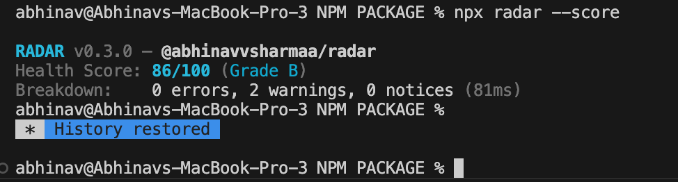

# RADAR – NPM Package Demo & Testing

This repository serves as the demo and testing environment for my published npm package, RADAR. I used this project to install, execute, and verify the package's functionality in a practical development environment.

[](https://www.npmjs.com/package/@abhinavvsharmaa/radar)
[](LICENSE)

---

## Terminal Testing Proof

<div align="center">



*RADAR successfully executed and tested in the terminal. All tested functionalities worked as expected.*

</div>

---

## Testing Summary

- **Package Installation & Execution:** Verified execution of the published `@abhinavvsharmaa/radar` package via `npx radar --score`.
- **Health Scoring Engine:** Successfully computed project health score (**86/100, Grade B**).
- **Rule Verification:** Evaluated project diagnostics across security, quality, structure, and environment rules (0 errors, 2 warnings, 0 notices in 81ms).
- **Practical Verification:** Confirmed stable CLI execution and output formatting in a real development environment.

---

## About This Demo Repository

This GitHub repository was specifically created to demonstrate the practical usage and successful testing of the RADAR npm package.

This is the demo project where the published npm package was tested, verified, and benchmarked against real-world project files, confirming its production readiness.

---

## Official NPM Package

Explore the published npm package, documentation, and installation options:

👉 **NPM:** [https://www.npmjs.com/package/@abhinavvsharmaa/radar](https://www.npmjs.com/package/@abhinavvsharmaa/radar)

```bash
npm install -g @abhinavvsharmaa/radar
# or execute directly:
npx @abhinavvsharmaa/radar --score
```
